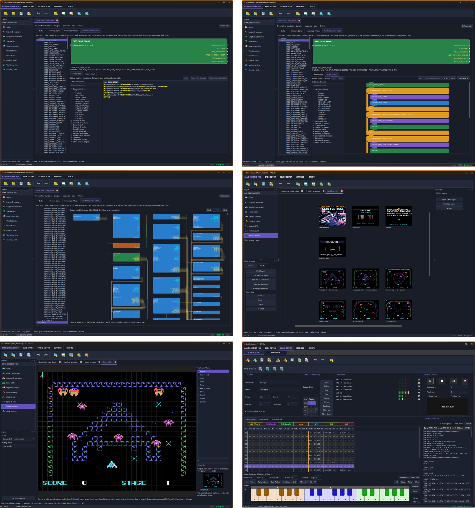

# CVSUITE
CVSUITE -  VISUAL GAME DESIGNER

---

This software is free to use for personal, educational, and non-profit purposes.

- Certain portions of the software are subject to third-party copyright, prohibiting the commercial use of this compilation.
- All C++ code is 100% authored by me and is permitted for use for all purposes.

A ColecoVision VISUAL GAME DESIGNER SUITE for Windows & Linux.

---

## 💾 Downloads

---

## 🗳️ What do you think of CVSuite?

Would you use the CVSuite Visual Game Designer?

👉 **[Vote in the poll](https://github.com/dvdh1961/CVSUITE/discussions/1)**

---

## 🚀 Versions

Version CVS_V1.0.10.26 x86_64 Windows & Linux

Our CVSuite Visual Game Designer is a standalone development environment for designing, programming, compiling and testing ColecoVision games, featuring a built-in emulator based on ADAM+.
1. Project and hardware configuration
   - Create, open and save game projects.
   - ROM sizes of 32, 128, 256, 512 and 1024 KB.
   - Optional Super Game Module (SGM) support.
   - Choose between the classic TMS9918 and F18A.
   - Game profiles, including shoot ’em up and board game, for genre-specific behaviour.
2. Visual programming
   - Build game logic using connected blocks.
   - Work with events, functions and inline blocks.
   - View input and output variables directly on blocks.
   - Follow GOSUB connections by double-clicking to open the corresponding block.
   - Manage global variables.
   - Combine visual programming with CVBasic code.
3. Reusable block library
   - Reusable building blocks for different games.
   - Configure behaviour through parameters and switches.
   - Identify shared library blocks by their yellow border.
   - Reuse common logic for controls, movement and game progression.
4. World, scene and level design
   - View the overall game structure and its scenes.
   - Build playfields using tiles and objects.
   - Place and move objects.
   - Configure room connections and doors.
   - Set level order and progression.
   - Use different enemies, objects and settings in each level.
5. Tiles, sprites and animation
   - Dedicated tile and sprite editors.
   - 8×8, 16×16 and 32×32 sprite designs, depending on their construction.
   - Edit animation frames, colours and palettes.
   - Reorder tiles and sprites.
   - F18A ECM2 and ECM3 support for more colourful graphics.
6. Image conversion
   - Import complete BMP images or selected sections.
   - Convert bitmaps for the selected video mode.
   - Use dithering and preview the results.
   - Shift images vertically to adjust their positioning.
   - Continue editing converted graphics.
7. Gameplay configuration
   - Joypad and keyboard controls.
   - Enemy movement, random movement and staggered spawning.
   - Shooting, enemy return fire and collision detection.
   - Explosion animations and player respawning.
   - Appearance effects, including a zoom effect.
   - Scores, lives and configurable score thresholds for extra lives.
8. Presentation screens and HUD
   - Welcome screens and game menus.
   - Story screens.
   - Hall of Fame, high scores and name entry.
   - HUD elements such as score, lives and level.
   - Backgrounds, text, scrolling text and selection animations.
   - Music assigned to individual screens.
9. Music and sound
   - Integrated Sound Editor.
   - Load and preview songs.
   - Manage and preview sound effects for each game.
   - Play music once or loop it.
   - Connect sounds to game events.
10. Compilation and memory management
    - Generate CVBasic source code.
    - Compile games into ROM files.
    - Check hardware requirements and memory banks.
    - Automatic bank allocation for larger games.
    - ROM output named after the project.
11. Built-in game testing
    - Compile and run from the same environment.
    - Integrated ColecoVision emulator.
    - Two-player support.
    - Keyboard controls and an on-screen joypad overlay.
12. Integrated workspace
    - Visual designer, BASIC editor and Sound Editor in one application.
    - Dark and light themes.
    - Retro toolbar icons and a built-in English guide.
    - Project tools become available after creating or opening a project.
From graphics and game logic to a playable ColecoVision ROM—all within one application. The recently updated F18A conversion and automatic bank allocation are still being refined.

---
