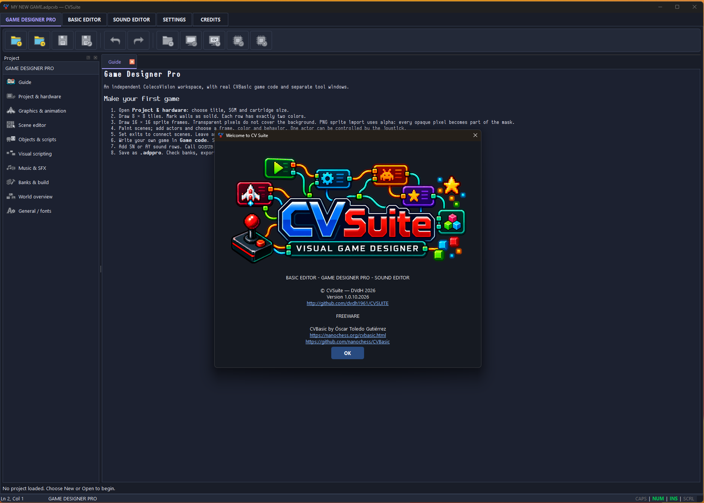

# CVSUITE
CVSUITE -  VISUAL GAME DESIGNER

---

This software is free to use for personal, educational, and non-profit purposes.

- Certain portions of the software are subject to third-party copyright, prohibiting the commercial use of this compilation.
- All C++ code is 100% authored by me and is permitted for use for all purposes.

A ColecoVision VISUAL GAME DESIGNER SUITE for Windows & Linux.

---

## 💾 Downloads

---

## 🚀 Versions

Version x x86_64 Windows & Linux

---
